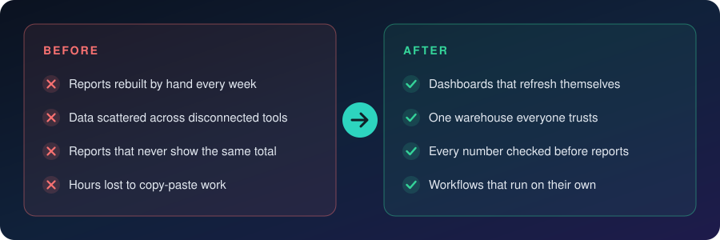
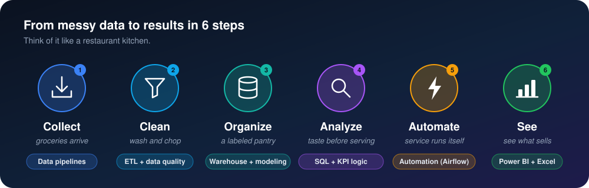
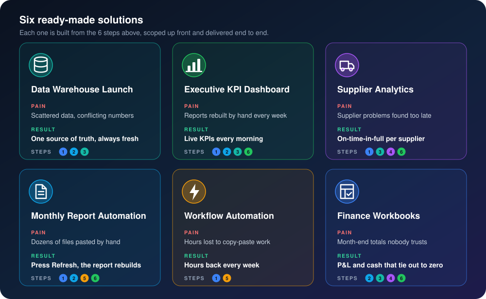
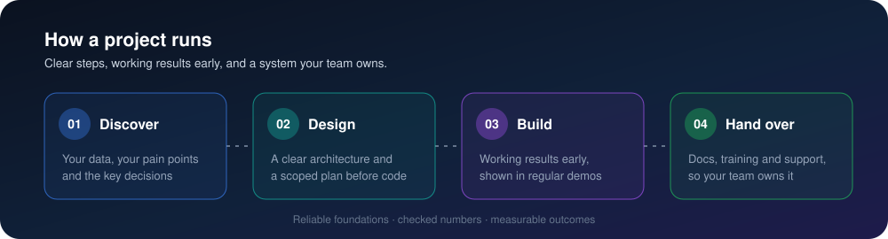

<p align="center">
  
</p>

<p align="center">
  
</p>

<p align="center">
  <a href="mailto:omarshalaby.data@gmail.com"></a>
  <a href="https://omarlabs.dev"></a>
  <a href="https://www.linkedin.com/in/omarshalaby1/"></a>
  
</p>

<h3 align="center">Data Analytics Engineering | BI Developer</h3>

<p align="center">I turn scattered business data into a trusted warehouse, tested SQL models and Power BI dashboards<br>that save your team hours and sharpen every decision.</p>

<p align="center"><b>Domain expertise:</b> retail supply chain (supplier invoicing, purchase orders, retailer deductions, freight and logistics charges) and automotive service operations.</p>

<p align="center">
  <sub><b>WORKED WITH</b></sub><br><br>
  &nbsp;&nbsp;&nbsp;&nbsp;
  &nbsp;&nbsp;&nbsp;&nbsp;
  
</p>

<p align="center">
  
  
  
  
  
  
  
  
  
  
  
  
</p>

## 🔍 The problem

<p align="center">
  
</p>

## 🧠 The idea, in 6 steps

<p align="center">
  
</p>

## 📦 What I deliver

<p align="center">
  
</p>

<p align="center">
  <b>Built for:</b>&nbsp;
  
  
  
  
  
  
</p>

## ⭐ Featured projects

<p align="center">
  
</p>

<p align="center"><a href="https://null-labs.io/">See Argus, the product →</a></p>

## 🚀 How we work together

<p align="center">
  
</p>

## 💡 Why me

- ✅ **Production-grade, not demos:** tested, monitored and documented to run every day.
- ✅ **End to end:** one engineer from raw data to warehouse, automation and dashboards.
- ✅ **Business first:** I start from the decision you need to make, then pick the tools.
- ✅ **You own it:** clean code and documentation your team can run without me.

## 🎯 Areas of expertise

<div align="center">
<table>
<tr>
<td align="center" width="25%">

<br><b>Data Engineering</b>
<br><br>Pipelines • Airflow • dbt<br>Warehousing • Data Modeling • Spark
</td>
<td align="center" width="25%">

<br><b>Analytics Engineering</b>
<br><br>SQL • dbt • Star schemas<br>Data quality checks • Testing
</td>
<td align="center" width="25%">

<br><b>Automation</b>
<br><br>Airflow workflows • Playwright<br>Selenium • API integrations
</td>
<td align="center" width="25%">

<br><b>BI and Analytics</b>
<br><br>Power BI • DAX • Power Query<br>Excel • Streamlit
</td>
</tr>
</table>
</div>

## 🧩 Under the hood

For technical readers: your data in one system, the tools behind it, and every skill.

<p align="center">
  
</p>

### 💻 Tech stack

<p align="center">
  
</p>

<h4 align="center">🗄️ Languages and databases</h4>
<p align="center">
  &nbsp;&nbsp;
  &nbsp;&nbsp;
  &nbsp;&nbsp;
  &nbsp;&nbsp;
  &nbsp;&nbsp;
  &nbsp;&nbsp;
  &nbsp;&nbsp;
  &nbsp;&nbsp;
  &nbsp;&nbsp;
  &nbsp;&nbsp;
</p>

<h4 align="center">🏗️ Data engineering and big data</h4>
<p align="center">
  &nbsp;&nbsp;
  &nbsp;&nbsp;
  &nbsp;&nbsp;
  &nbsp;&nbsp;
  &nbsp;&nbsp;
  &nbsp;&nbsp;
</p>

<h4 align="center">☁️ Cloud</h4>
<p align="center">
  &nbsp;&nbsp;
  &nbsp;&nbsp;
  &nbsp;&nbsp;
  &nbsp;&nbsp;
</p>

<h4 align="center">⚙️ Automation</h4>
<p align="center">
  &nbsp;&nbsp;
  &nbsp;&nbsp;
  &nbsp;&nbsp;
  &nbsp;&nbsp;
</p>

<h4 align="center">📊 BI and analytics</h4>
<p align="center">
  &nbsp;&nbsp;
  &nbsp;&nbsp;
  &nbsp;&nbsp;
</p>

<h4 align="center">🛠️ Tools</h4>
<p align="center">
  &nbsp;&nbsp;
  &nbsp;&nbsp;
  &nbsp;&nbsp;
  &nbsp;&nbsp;
</p>


<details>
<summary><b>📚 Full skill map: 9 areas from my training (click to open)</b></summary>
<br>

<details>
<summary><b>🗄️ Databases and SQL</b></summary>

- Relational design: ERDs, keys, constraints and normalization
- SQL: DDL, DML, joins, subqueries, CTEs and aggregations
- Performance: indexing, execution plans, partitioning and query tuning
- NoSQL data modeling, CAP theorem and replication

</details>
<details>
<summary><b>🏗️ Data warehousing and data modeling</b></summary>

- OLTP vs OLAP; data warehouse, data lake and lakehouse
- Dimensional modeling: fact tables, dimensions, grain, slowly changing dimensions
- Star and snowflake schemas, and when to use each
- Layered warehouses: staging, core and presentation (bronze, silver, gold)
- Materialized views and aggregates for fast reporting
- dbt: staging, intermediate and mart models, tests, docs and lineage

</details>
<details>
<summary><b>🔄 Data pipelines and orchestration</b></summary>

- ETL vs ELT; full vs incremental loads
- Extraction from databases, files and REST APIs
- Apache Airflow: DAG design, operators, scheduling, retries, monitoring and logging
- End-to-end batch and streaming pipelines with Kafka, Spark and Airflow

</details>
<details>
<summary><b>☁️ Cloud and big data</b></summary>

- Azure Data Lake Storage and Blob Storage, file formats
- Azure Data Factory: pipelines, linked services, datasets and triggers
- Azure Databricks and Apache Spark: DataFrames, Spark SQL, caching and partitioning
- Hadoop: HDFS, YARN and MapReduce
- Kafka: topics, partitions, consumer groups, delivery guarantees, Kafka Streams

</details>
<details>
<summary><b>🧹 Data quality and governance</b></summary>

- Data quality checks, validation and handling bad data
- Data cataloging, lineage and metadata management
- Data ownership, security, access control and compliance

</details>
<details>
<summary><b>🐍 Python for data</b></summary>

- pandas and NumPy for cleaning and transformation
- REST APIs with requests and JSON parsing; automation scripts and scheduling
- asyncio and aiohttp, dataclasses and Pydantic validation
- FastAPI: async APIs, WebSockets, background tasks, streaming and Docker deployment

</details>
<details>
<summary><b>⚙️ Automation</b></summary>

- Airflow-scheduled workflows with retries, monitoring and alerts
- Browser automation and web scraping with Playwright, Selenium and Beautiful Soup
- API integrations that move data between systems

</details>
<details>
<summary><b>📊 Power BI</b></summary>

- Power Query (M) for cleaning and shaping data
- Star-schema models, relationships and cardinality
- DAX: CALCULATE, filter context, variables and time intelligence
- Dashboard design: drill-through, bookmarks and tooltips
- Row-level security, publishing and scheduled refresh in Power BI Service

</details>
<details>
<summary><b>📈 Excel</b></summary>

- XLOOKUP, INDEX/MATCH and dynamic arrays
- PivotTables and PivotCharts
- Power Query and Power Pivot with DAX
- Interactive dashboards, data validation and conditional formatting
- VBA and macros for report automation

</details>

</details>

## 💡 What I'm up to


```python
current_focus = {
    "building": ["Argus: every Walmart deduction matched, explained and ready to dispute",
                 "One source of truth and Power BI dashboards for a car-service business"],
    "deepening": ["dbt and analytics engineering", "Data quality testing",
                  "Power BI semantic models"],
    "open_to": "Full-time, contract and project work in Data Analytics Engineering and BI",
    "goal": "Data systems that run themselves",
}
```

## 🤝 Let's work together

<p align="center">
  
</p>

<p align="center"><b>Ready to stop doing work by hand?</b></p>

<p align="center">
  <a href="mailto:omarshalaby.data@gmail.com"></a>
  <a href="https://omarlabs.dev"></a>
  <a href="https://www.linkedin.com/in/omarshalaby1/"></a>
</p>

<p align="center">
  <picture>
    <source media="(prefers-color-scheme: dark)" srcset="https://raw.githubusercontent.com/omarshalabyy1/omarshalabyy1/output/github-snake-dark.svg">
    
  </picture>
</p>

<p align="center">
  
</p>
